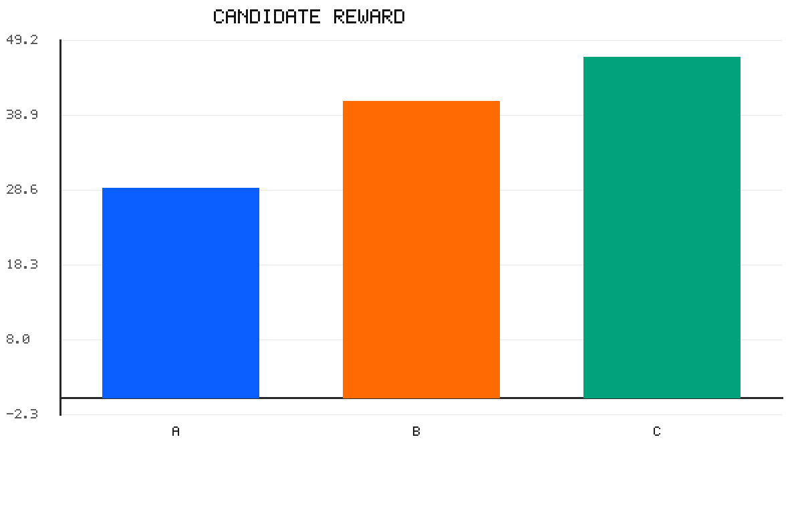
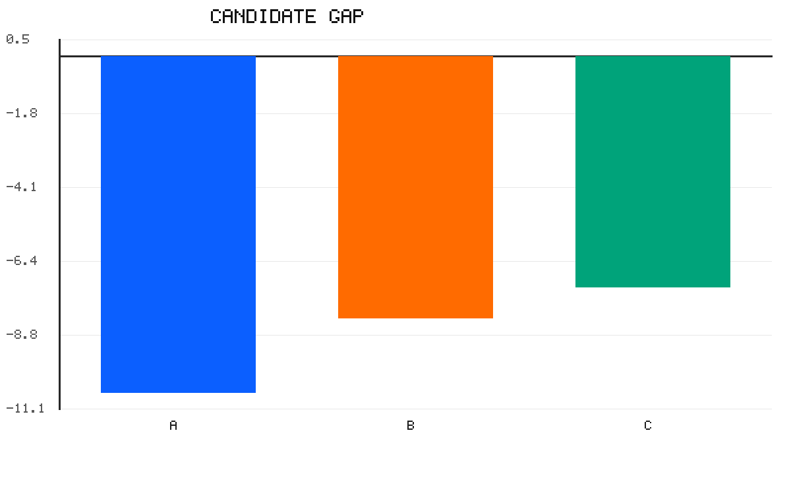
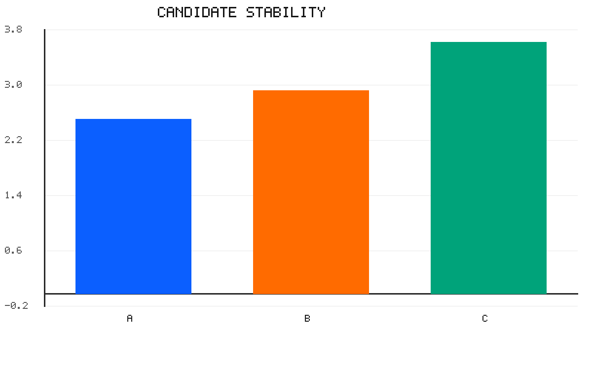
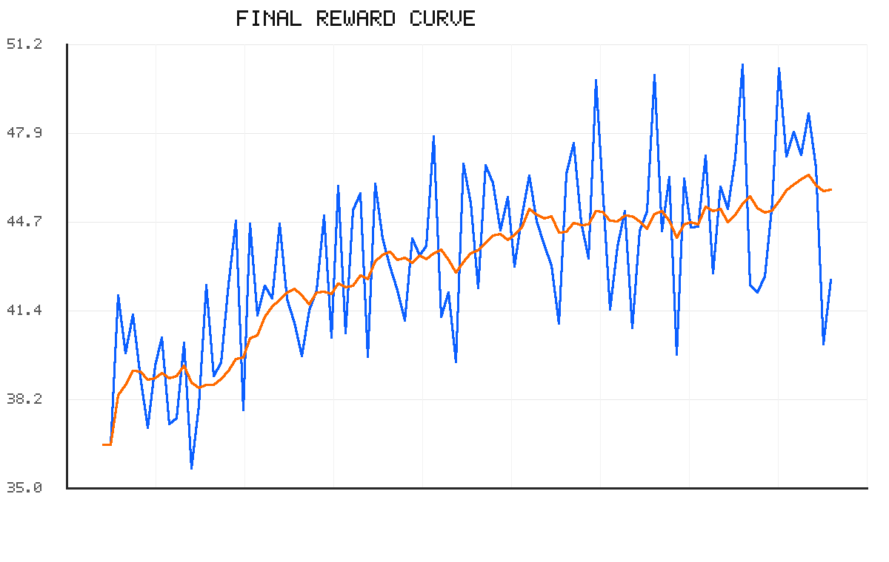
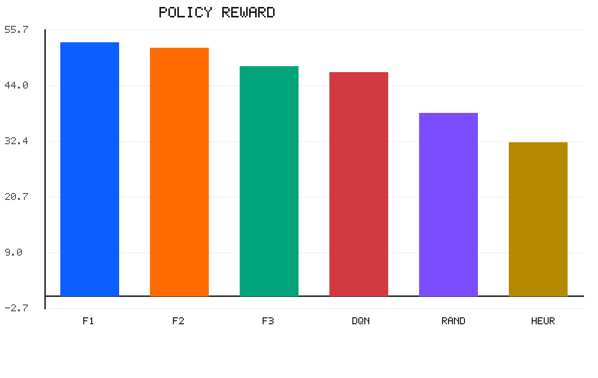
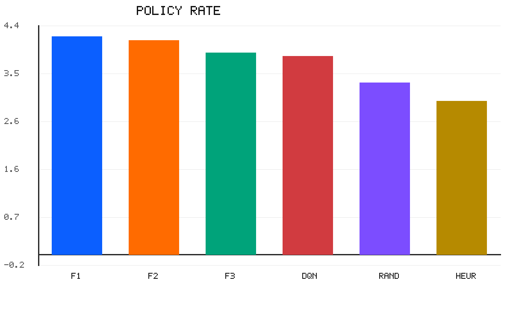
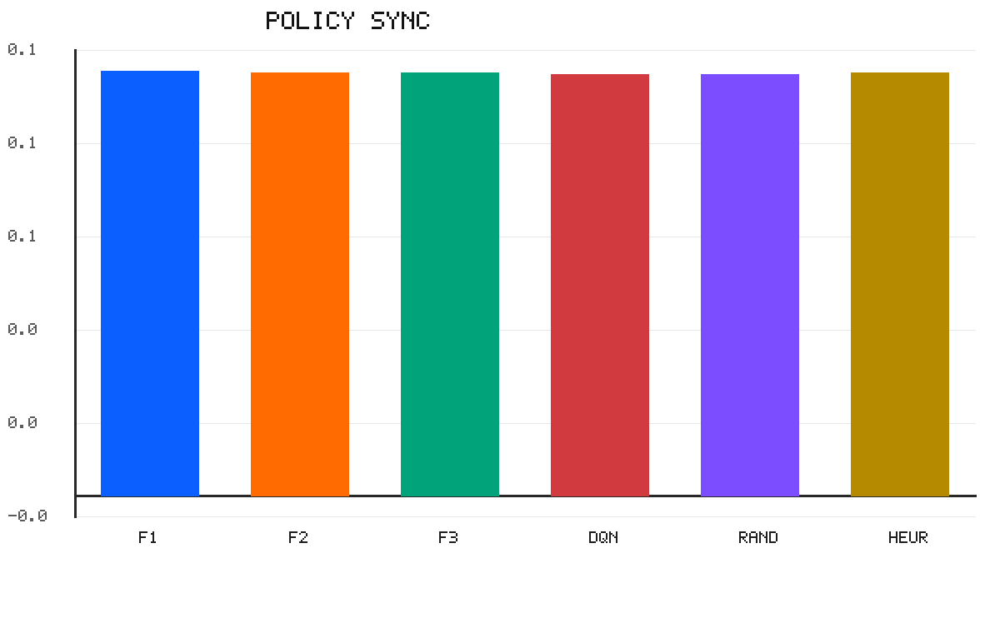
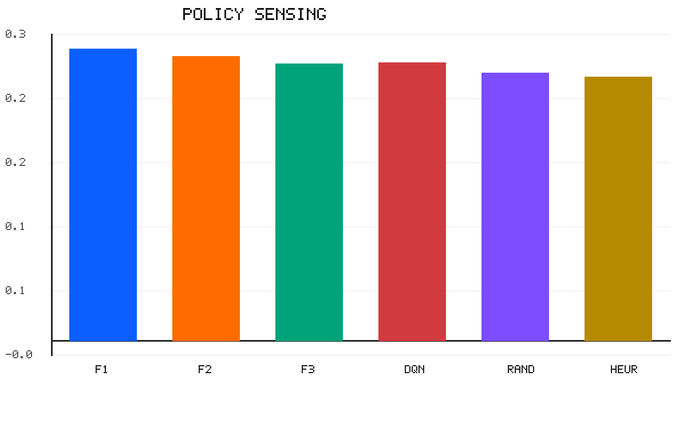
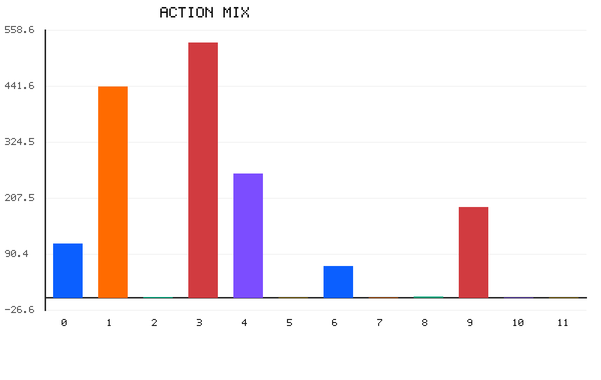

# Final Summary Report for Professor

## Executive Summary

This report summarizes the final proof-of-concept OFDM-ISAC reinforcement-learning experiments.

The strongest DQN setting among the final confirmed candidates was:

- `lambda_rate = 1.0`
- `lambda_sync = 0.2`
- `lambda_sensing = 0.4`

Important conclusion:

- the DQN outperformed the random and heuristic baselines
- but it did **not** outperform the best fixed baseline on average across the final multi-seed confirmation runs
- the best fixed baseline should be interpreted as the hindsight-best constant-action policy among the tested fixed actions, not as an adaptive online controller

So the final result is a valid proof-of-concept RL implementation, but not a decisive adaptive-policy win over the strongest fixed pilot policy under the tested setup.

## Final Setup

- sensing mode: `empirical`
- reward normalization: enabled
- project scope: proof-of-concept simulation study
- confirmation episodes per run: `100`
- frames per episode: `64`
- evaluation episodes per run: `5`
- final confirmation seeds: `7,17,27,37,47`

## Final Candidate Comparison

Candidate labels used in the figures:

- `A` = (lambda_sync=0.4, lambda_sensing=0.5)
- `B` = (lambda_sync=0.25, lambda_sensing=0.5)
- `C` = (lambda_sync=0.2, lambda_sensing=0.4)

Selected winner: `C`

Interpretation:

- the chosen candidate had the best final selection score among the confirmed settings
- however, its mean gap to the best fixed baseline was still negative: `-7.2461`
- this fixed-baseline comparison is intentionally strict because it compares DQN against the hindsight-best constant action after evaluation

## Final Chosen Setting

- mean DQN reward: `46.8887`
- mean gap to best fixed baseline: `-7.2461`
- stability score: `3.6148`
- mean DQN rate: `3.8497`
- mean DQN sync mismatch: `0.0998`
- mean DQN sensing metric: `0.2856`

Best fixed baseline under the same final setting:

- policy: `fixed_rho=0.1_beta=0.2`
- mean reward: `53.0463`
- mean rate: `4.2288`
- mean sync mismatch: `0.1005`
- mean sensing metric: `0.2992`

## Learning Behavior

The reward curve improves over training, but it remains noisy. This is consistent with a stochastic RL environment and does not represent perfectly smooth convergence.

## Policy Comparison

Figure label mapping:

- `F1` = `fixed_rho=0.1_beta=0.2`
- `F2` = `fixed_rho=0.2_beta=0.2`
- `F3` = `fixed_rho=0.3_beta=0.2`
- `DQN` = learned policy
- `RAND` = random baseline
- `HEUR` = heuristic baseline

Interpretation:

- the DQN is competitive with strong fixed baselines
- the DQN is stronger than the random and heuristic policies
- the best fixed baseline still remains ahead on average reward
- this does not make the DQN useless; it means the adaptive policy did not beat the hindsight-best constant policy under the final tested setup

## Learned Action Behavior

This figure shows how often the final DQN selected each of the 12 discrete actions during evaluation.

## Final Assessment

What the project successfully demonstrates:

- the OFDM-ISAC model can be implemented in a working RL simulator
- the DQN learns a nontrivial adaptive control policy
- the selected reward weights meaningfully affect the communication/synchronization/sensing tradeoff

What the project does **not** currently demonstrate:

- consistent superiority over the best fixed baseline
- cleanly settled reward convergence across all final runs
- hardware-readiness
- generalization to materially changed simulator regimes such as different noise levels, CFO dynamics, or channel-correlation settings

## Recommended Report Framing

Recommended wording for the final writeup:

- present this as a proof-of-concept adaptive pilot/power-control study
- state that the DQN outperformed simple baselines such as random and heuristic policies
- state that the best fixed baseline remained stronger on average under the final confirmation runs
- explain that this fixed baseline is the hindsight-best constant action among the discrete fixed policies, which is a stricter benchmark than a pre-chosen deployable fixed policy
- present the result as evidence that adaptive RL control is feasible, but not yet dominant under the current simulator setup

## Clarification on Seeds vs Generalization

The final confirmation used five random seeds. This shows that the result is not based on a single lucky rollout of the same simulator setup.

What the five seeds do support:

- repeatability across different random channel, CFO, and noise trajectories under the same simulator family
- reduced risk that the reported result is due to one favorable random draw

What the five seeds do **not** prove:

- robustness to changed noise variance
- robustness to changed CFO-drift parameters
- robustness to changed channel-correlation parameters
- robustness to changed sensing-metric definitions
- broad transfer to materially different environment families

So the multi-seed result supports repeatability within the same simulator family, but not broad cross-regime generalization.

## Notes

- additional images can be inserted into this markdown file later if needed
- all values in this report come from the generated confirmation artifacts, not from manual transcription
